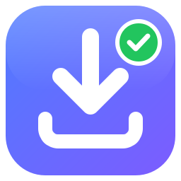

<p align="center">
  
</p>

<h1 align="center">DescarGO</h1>
<p align="center"><b>Descarga y listo</b> — video y audio de cualquier página pública, rápido y seguro.</p>
<p align="center">© 2026 <a href="https://lliuya.pe">lliuya.pe</a> — Todos los derechos reservados</p>

---

## ¿Qué hace?

| | |
|---|---|
| 🌐 **Fuentes** | YouTube, Facebook, Facebook Reels, Instagram, TikTok, Vimeo, X, Twitch, Reddit, SoundCloud… más de 1.800 sitios, además de un detector genérico para páginas con video y enlaces directos `.mp4` / `.mp3`. |
| 🎬🎵 **Tú eliges** | Antes de descargar: **video o solo audio**, la **calidad** (solo se muestran las que existen de verdad: 8K, 4K, 2K, 1080p 60fps, HDR…), el formato y los subtítulos. |
| 🎵 **Audio** | Original sin recomprimir (recomendado), MP3, M4A, OPUS, OGG, FLAC y WAV, a 320, 256, 192 o 128 kbps. |
| 🔑 **Planes** | **Gratis:** descargas ilimitadas en calidad estándar (480p / 128 kbps). **Con licencia:** alta calidad (HD, 4K, 320 kbps). Cola con pausa, reanudación y cancelación, sin publicidad. |
| 📚 **Listas y perfiles** | Marca qué elementos de una lista quieres. Lo que ya descargaste se omite (descarga incremental). |
| 🛡️ **Seguridad** | Cada archivo pasa por cuarentena y un análisis de 5 capas antes de llegar a tu carpeta. |
| 🚫 **Uso responsable** | Bloquea páginas de pago (Netflix, Disney+, Spotify, Udemy, OnlyFans…) y contenido con DRM. |
| 🔄 **Siempre al día** | El motor de descarga se actualiza solo (verificado con SHA-256) y la app avisa cuando hay una versión nueva. |
| 🎵 **Portadas** | MP3, M4A, OPUS, FLAC y MP4 guardan la miniatura como carátula, con título y artista. |
| 🔔 **Avisos** | Notificación de Windows al terminar una descarga o bloquear una amenaza. |
| ☕ **Invítame un café** | Apoyo voluntario por Yape: **925 459 643**. |

## 🛡️ Cómo protege tu computador

```
Descarga → carpeta de CUARENTENA aislada
   1. Tipo real del archivo: lee su firma interna (no confía en la extensión) y lo valida con FFprobe
   2. Bloqueo de .exe, .bat, .scr, .js…, dobles extensiones (video.mp4.exe) y nombres disfrazados (Unicode RTLO)
   3. Subtítulos: solo texto plano, sin scripts
   4. Antivirus del sistema: Microsoft Defender (Windows) o ClamAV (Mac/Linux)
   5. VirusTotal (opcional): solo se envía la huella SHA-256, nunca el archivo
→ ✅ Seguro: se mueve a tu carpeta  ·  ⚠️ Sospechoso: queda en cuarentena  ·  ❌ Amenaza: se elimina
```

Las capas 1 a 3 y el bloqueo de páginas de pago **no se pueden desactivar**. Si una descarga falla a medias, lo que llegó también se analiza y nunca se entrega un archivo incompleto.

## 💻 Instalar en Windows

**Opción A, descargar la versión publicada:** entra a [**Releases**](https://github.com/jhuniorgalvesll/plugin/releases) y descarga `DescarGO-Setup-X.Y.Z.exe`. También puedes bajar la compilación más reciente desde **Actions → «DescarGO — compilar para Windows»** → `DescarGO-Setup-Windows`.

**Opción B, compilar tú mismo:** con [Python 3.12](https://www.python.org/downloads/) instalado, abre PowerShell en la carpeta `descargo`:

```powershell
powershell -ExecutionPolicy Bypass -File build_windows.ps1
```

El script instala las dependencias, descarga FFmpeg **comprobando su huella SHA-256**, ejecuta las pruebas y genera `dist\DescarGO\DescarGO.exe`. Si tienes [Inno Setup 6](https://jrsoftware.org/isdl.php), también genera el instalador `dist\DescarGO-Setup-1.0.0.exe`.

## 🧑‍💻 Ejecutar desde el código (Windows, Mac o Linux)

```bash
cd descargo
python -m venv .venv
.venv/bin/pip install -r requirements-dev.txt     # en Windows: .venv\Scripts\pip
.venv/bin/python run.py
```

Necesitas FFmpeg instalado (`winget install Gyan.FFmpeg`, `brew install ffmpeg` o `sudo apt install ffmpeg`) o copiar `ffmpeg` y `ffprobe` en `descargo/descargo/bin/`.

Pruebas automáticas:

```bash
.venv/bin/python -m pytest -q tests
```

## 🚀 Publicar una versión nueva

1. Sube el número en `descargo/descargo/__init__.py` (`APP_VERSION`) y agrega sus novedades en `descargo/descargo/changelog.py`.
2. Sube el cambio a GitHub.

GitHub ejecuta las pruebas, compila el instalador y, si esa versión todavía no está publicada, la publica en **Releases** con su `.exe` y su `.sha256`. Los usuarios reciben el aviso de actualización dentro de la app.

## 🔑 Licencias

- **Sin licencia** (plan gratuito o licencia vencida): descargas **ilimitadas** en **calidad estándar** — video hasta 480p y audio hasta 128 kbps.
- **Con licencia:** **alta calidad** — HD, Full HD, 2K, 4K, 60fps, HDR, audio 320 kbps, FLAC y audio original. Va ligada al **código de equipo** del cliente, puede ser permanente o vencer (1–12 meses, 2 años o una fecha), y está firmada digitalmente (Ed25519): no se puede falsificar ni usar en otro computador.
- Al vencer, la app avisa y sigue descargando en calidad estándar hasta que se renueve.

**Vender una licencia:** el cliente abre **Licencia** en la app, copia su código de equipo y te lo envía con la captura del Yape. Tú abres **🛠 Generar licencias** (solo aparece en tu computador), escribes nombre, código y duración, y le envías la clave `DGO1-…`.

**Tu computador (modo autor):** con la llave privada en `%APPDATA%\DescarGO\`, la app detecta que eres el autor: descargas ilimitadas, sin licencia, y aparece el generador. La app verifica que sea la llave real; un archivo falso no sirve.

> La llave privada (`descargo-licencias.key`) va en `%APPDATA%\DescarGO\` **solo en tu computador**. Nunca la subas a GitHub ni la compartas: con ella cualquiera podría crear licencias.

## 📁 Estructura

```
descargo/
├── run.py                    # lanzador
├── descargo/
│   ├── app.py                # arranque, tema, términos de uso
│   ├── config.py             # ajustes (JSON)
│   ├── core/
│   │   ├── analyzer.py       # lee calidades reales de cada enlace
│   │   ├── formats.py        # traduce tu elección a opciones de yt-dlp
│   │   ├── downloader.py     # cuarentena → análisis → carpeta final
│   │   ├── security.py       # escáner de 5 capas
│   │   ├── policy.py         # bloqueo de páginas de pago y DRM
│   │   ├── updater.py        # actualización del motor y de la app
│   │   └── library.py        # historial SQLite (evita duplicados)
│   ├── ui/                   # ventanas (PySide6 / Qt)
│   └── assets/               # logo e iconos
├── tests/                    # pruebas automáticas
├── packaging/                # PyInstaller, instalador e información de versión
└── build_windows.ps1
```

Los ajustes, el historial y la cuarentena se guardan en `%APPDATA%\DescarGO` (Windows), `~/Library/Application Support/DescarGO` (Mac) o `~/.config/descargo` (Linux).

## ⚖️ Uso responsable

DescarGO está pensado para descargar **contenido propio, con licencia libre o con permiso de su autor**. No descarga contenido de pago ni evade protecciones DRM. Respeta los términos de cada plataforma y los derechos de autor; el usuario es responsable del uso de los archivos descargados.

Las plataformas cambian a menudo. Si una deja de funcionar, actualiza el motor con `pip install -U yt-dlp` y vuelve a compilar.

## 📜 Derechos

**© 2026 lliuya.pe — Todos los derechos reservados.** Queda prohibida la reproducción, distribución o modificación de este software sin autorización del titular.

Componentes de terceros, cada uno con su propia licencia: [yt-dlp](https://github.com/yt-dlp/yt-dlp) (Unlicense), [FFmpeg](https://ffmpeg.org) (LGPL), [Qt / PySide6](https://www.qt.io/qt-for-python) (LGPL).

## ☕ Invítame un café

Si DescarGO te es útil, puedes apoyar su desarrollo por **Yape** al número **925 459 643**. ¡Gracias! 💜
